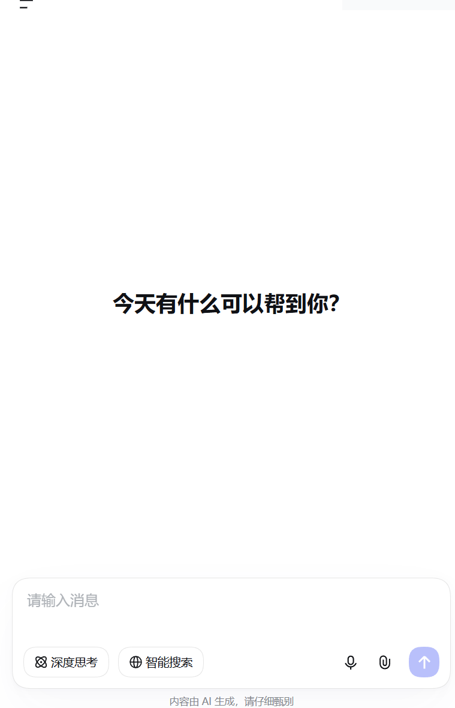

# My DeepSeek

[](https://www.npmjs.com/package/dsh-plugin-my-deepseek)
[](https://github.com/WSK-build/dsh-plugin-my-deepseek/actions/workflows/ci.yml)
[](https://www.npmjs.com/package/dsh-plugin-my-deepseek)
[](LICENSE)

**The official DeepSeek chat front end in four shapes: a DSH plugin panel, an Android app, a
HarmonyOS app, and a web demo.** The UI is the real
[`deepseek-ai/chat-demo`](https://github.com/deepseek-ai/chat-demo) — not an imitation — and all four
shapes share one web layer.

English · [简体中文](README.md)

## Four shapes

| Shape | How to get it | Needs | Sign-in | Where conversations live |
| --- | --- | --- | --- | --- |
| **DSH plugin panel** | install the npm package, enable the bundle in DSH | DSH `>= 0.2.2-rc.1` | API key only | local disk, one JSON file per conversation |
| **Android app** | install the APK (from CI or a local build) | Android 10+, system WebView ≥ 110 | API key **or** DeepSeek account | the app's private IndexedDB |
| **HarmonyOS app** | install the HAP (**not produced yet**, see below) | HarmonyOS NEXT | API key **or** DeepSeek account | the app's private IndexedDB |
| **Web demo** | open the Pages site | a modern browser | API key only | memory only, gone on refresh |

The UI, shortcuts, conversation forking and context compaction are identical everywhere; only host
capabilities and storage differ. "Only" means that shape genuinely has no second sign-in path — not
that one is still missing.

> The HarmonyOS path stops at sources and configuration: there is no DevEco or HarmonyOS SDK on the
> machine that built this, so it has **never been compiled** and there is no installable HAP yet. Use
> Android or the web demo in the meantime.

## Screenshots

| Desktop | Mobile |
| --- | --- |
|  |  |
|  |  |

## 1. As a DSH plugin panel

The plugin panel is a DSH bundle: the host half (`dsh-plugin/index.js`) runs inside the DSH process and
serves the conversation-store routes, while the client half (`dsh-plugin/dist/client.js`) renders the
panel. It only works inside DSH and cannot be opened on its own.

### Requirements

| | |
| --- | --- |
| DSH | `>= 0.2.2-rc.1` (declared as `engines.dsh`; verified on 0.2.2-rc.1 and 0.2.2-rc.3, older runtimes are refused) |
| DeepSeek API key | required — you provide your own, it is never bundled |
| Node.js | **not needed** — the built bundle ships with the package |

### Option 1: plugin manager (recommended)

1. Open **Plugins** in DSH;
2. install `dsh-plugin-my-deepseek`;
3. enable the bundle — **My DeepSeek** appears in the sidebar.

### Option 2: command line

```bash
dsh plugin add dsh-plugin-my-deepseek
```

Then enable the bundle in **Plugins**.

### Option 3: from source

```bash
git clone https://github.com/WSK-build/dsh-plugin-my-deepseek.git
cd dsh-plugin-my-deepseek
pnpm install
pnpm build
```

Then install this directory as a bundle.

> **One copy per profile.** The host route prefix is fixed (`/my-deepseek/api`), so a second copy fails
> activation with a duplicate-route error. Switching from a local directory install to the npm version
> can fail with `EPERM` until the old copy is removed from the plugin manager.

## 2. As an Android app

By design the APK is produced by the `release` workflow on a version tag and attached to the Release.
**That pipeline has not actually run on GitHub yet**; what is verified is the local build path below.

| | |
| --- | --- |
| System | Android 10 (API 29) or newer |
| System WebView | major version **≥ 110** |
| Size | 13.1 MB (debug build; pure WebView, no native libraries) |

When the system WebView is too old the app shows an update prompt instead of a blank page — both the
UI and the platform sign-in page need a modern engine. On ROMs without Google Play, update
"Android System WebView" from the system settings.

Local build:

```bash
pnpm build:mobile            # repository root, writes build/mobile/www
.\android\build-apk.cmd      # stage into webDir -> cap sync -> assembleDebug
.\android\build-apk.cmd -Release   # unsigned release
```

The default Windows execution policy blocks `.ps1`, so the entry point is a `.cmd` that runs the
script with a Bypass scope for the current process only (no system setting is changed). Building needs
JDK 21 and the Android SDK.

## 3. As a HarmonyOS app

`harmony/` is an ArkTS + ArkWeb shell that loads the same page bundle as Android.
**This path has never been compiled**: DevEco Studio and the HarmonyOS SDK need a Huawei account to
download, so a hosted CI cannot install them. The HAP is expected to come from a Huawei Cloud
CodeArts HarmonyOS build and be attached back to the Release.

What differs on this platform: the authorization page opens in the system browser, and the loopback
callback is received by a TCP server inside the app.

## 4. As a web demo

A "use it and leave" build on GitHub Pages that **stores nothing**.

| Data | Handling |
| --- | --- |
| Conversations | memory, gone on refresh |
| API key | memory, gone on refresh |
| Attachments | memory, gone on refresh |
| UI preferences | memory, reset on refresh |
| History import | not offered |
| Account sign-in | unavailable (no native bridge; the row hides itself) |

A closable notice bar at the top of the page states this.

## Sign-in

| Shape | API key | DeepSeek account |
| --- | --- | --- |
| DSH plugin panel | yes | no (no native bridge, so the row hides itself) |
| Android app | yes | yes |
| HarmonyOS app | yes | yes |
| Web demo | yes | no (no native bridge, so the row hides itself) |

**Use either one.** Account sign-in runs inside the app's WebView, stores the token in the platform
keystore, and lets the native side attach the credential — the web layer never sees the token.
Once signed in, no API key is needed.

One known limitation: **uploading attachments requires an API key**, because the upload endpoint only
accepts `x-api-key`. With account-only sign-in the attachment button is disabled and says why.

## Features

- **The official front end**: multi-conversation history, automatic titles, message branches,
  regenerate, stop, continue, attachments (upload / paste / drag), voice input and read-aloud.
- **Deep thinking and web search** with source citations, streamed into the same UI.
- **Markdown, code highlighting, KaTeX and Mermaid**.
- **Conversation forking**: the branch icon at the right end of an assistant reply derives a new
  conversation from that reply. Titles number themselves (`A` → `A(1)` → `A(1-1)`), and the new
  conversation inherits the full message tree, so earlier versions stay switchable.
- **Context compaction**: Settings → General → context compaction, six strategies, defaulting to
  "DeepSeek Harness auto-summary". Compaction only changes **what is sent to the model**; the
  conversation keeps every original message, and exports are always complete.
- **ZIP history import/export** using the archive format the official app exports.

## Data and privacy

### DSH plugin panel

| Data | Stored in | Closing the browser | Clearing site data |
| --- | --- | --- | --- |
| Conversations (text, thinking, citations, search results) | local disk, `sessions/<id>.json` | survives | **survives** |
| API key | this browser's `localStorage` (per origin) | survives | lost, enter it again |
| Panel settings | same `localStorage` | survives | reset to defaults |
| Attachment originals | this browser's IndexedDB | survives | lost (messages stay, files do not open) |

Data directory (override with `DSH_CHAT_DATA_DIR`):

| Platform | Path |
| --- | --- |
| Windows | `%LOCALAPPDATA%\my-deepseek-panel\sessions` |
| macOS | `~/Library/Application Support/my-deepseek-panel/sessions` |
| Linux | `$XDG_DATA_HOME/my-deepseek-panel/sessions` (default `~/.local/share`) |

One file per conversation, written atomically (temp file + rename), so a crash cannot leave a
half-written session behind.

### Android / HarmonyOS

| Data | Stored in |
| --- | --- |
| Conversations and attachment originals | the app's private browser database, cleared on uninstall |
| API key | the same database (per origin) |
| Account token | the platform keystore, AES-GCM with a keystore-generated IV |
| Exported archives | the system Downloads folder (Android writes through MediaStore) |

### In general

`localStorage` is not a cache: closing the browser keeps it; a different browser, a private window or
a different port starts without it. **The API key stays on your machine and is never written to disk
by this project** — the UI calls `api.deepseek.com` directly.

There is no telemetry and no analytics. The only network calls are the ones you configured: the
DeepSeek API, plus `platform.deepseek.com` while signing in to an account.

## Import and export

Settings → Data management:

- **Import history** accepts the ZIP archive exported by the official DeepSeek app. Importing
  replaces the existing conversations.
- **Export** produces the same format, with the original image attachments when they are available
  locally.
  - DSH plugin panel and web demo: a normal browser download;
  - Android: written into the system Downloads folder, with the file name reported afterwards;
  - HarmonyOS: not implemented yet; the UI states that this platform cannot save the archive.

## Known limits

- **The HarmonyOS path has never been compiled**, and export plus streaming are not implemented there
  (export reports that clearly instead of pretending to succeed).
- **Conversations are not DSH sessions.** They are this project's own files: they do not appear in the
  DSH sidebar, session search, or the DSH session log. That is deliberate — it keeps the replica's
  fidelity (thinking signatures, inline citation anchors, server-side search blocks) intact and keeps
  the package independent of DSH's data model.
- **The model is not hard-coded**; without the server model list it falls back to `deepseek-flash`.
- **Attachment originals stay in the browser.** After clearing site data an old message still shows
  its text and file name, but opening the file fails. Deleting a conversation does not reclaim
  attachment originals that are no longer referenced.
- **Attachment upload needs an API key**, so it is unavailable with account-only sign-in.
- **Exporting a very large history** passes the archive through memory as base64; a multi-hundred-MB
  archive could strain a low-end device.
- **One copy per DSH profile.**

## Develop

```bash
pnpm install

pnpm build        # transform tokens -> rspack bundle -> wrap into a DSH client module
pnpm build:mobile # standalone page (shared by Android and HarmonyOS)
pnpm build:web    # web demo (memory-only)
pnpm test         # 66 unit tests (forking, request routing, compaction, circuit breaker)

pnpm run audit        # module id, externals, embedded CSS, privacy scan
pnpm run audit:load   # bundles really load (all build-time constants replaced)
pnpm run audit:i18n   # locale keys line up across languages
pnpm run audit:compat # syntax target plus above-floor API scan
pnpm run lint:compat  # above-floor API scan on sources
pnpm pack:check       # what npm would publish
```

```text
dsh-plugin/                 everything the npm package exposes
  index.js                  host half: the on-disk conversation store, one route prefix
  cordis.patch.yml          bundle patch
  dist/client.js            built client module (generated, not committed)
web/src/entries/            one entry per shape
  dsh.tsx                   mounts into the DSH plugin panel
  mobile.tsx                standalone page (Android / HarmonyOS / web demo)
web/src/shared/             account sign-in, store abstraction, model source, forking, compaction
web/src/components/         UI pieces shared by the shapes
web/src/styles/             root styles for the panel and for the standalone page
android/                    Android shell (Capacitor)
harmony/                    HarmonyOS shell (ArkTS + ArkWeb)
website/                    GitHub Pages web demo
vendor/chat-demo-src/       upstream demo source (see NOTICE for the exact changes)
scripts/                    token rename, bundling, wrapping, artwork extraction, audits
```

The entry points and build outputs live only under `dsh-plugin/`, and both `exports` and `files` in
`package.json` point there, so no module source ships in the npm package. `dsh-plugin/dist/` is
generated by `prepack`, so `npm publish` always ships a fresh bundle.

Changes to the vendored demo follow two rules: rewrite relative import specifiers so they reach this
project's modules, and insert small call sites into the demo's existing structure while the
implementation stays in `web/`. Each change is listed in `NOTICE`, which is the checklist to replay
when upgrading the upstream demo.

## Release

Publishing runs in CI; a local `npm login` is never required.

1. npmjs.com → Access Tokens → new **Granular** token: `read and write`, *All packages*;
2. store it as the repository secret `NPM_TOKEN`
   (Settings → Secrets and variables → Actions);
3. bump and tag:

   ```bash
   npm version patch --no-git-tag-version
   git commit -am "release: v0.1.2"
   git tag v0.1.2
   git push origin main --tags
   ```

4. The `release` workflow checks that the tag matches `package.json`, then runs three jobs in parallel:
   - build and `npm publish --provenance`;
   - build the debug APK (plus a signed release APK when the signing secrets are present) and attach
     it to the Release;
   - build the web demo and deploy it to GitHub Pages.

   Manual runs default to a dry run.

Pages needs a one-time setup: repository Settings → Pages → Source → **GitHub Actions**.

APK signing needs the secrets `ANDROID_KEYSTORE_BASE64`, `ANDROID_KEYSTORE_PASSWORD`,
`ANDROID_KEY_ALIAS` and `ANDROID_KEY_PASSWORD`, all four together: without the Base64 one only the
debug APK is produced, and missing either of the other three fails the signing step.

Provenance is only generated for a public repository, and `repository.url` must point at it.

## How it differs from the upstream demo

The upstream demo is a standalone static site. This project keeps its UI intact and changes only the
plumbing:

- design tokens are renamed into a private `--dsc-*` namespace and page rules are scoped to the panel —
  the panel keeps the official palette without touching DSH's own theme tokens;
- the sidebar title shows the official wordmark;
- conversation persistence moves from IndexedDB to the host half (DSH plugin panel), which writes one JSON
  file per conversation under the platform data directory;
- small call sites hook in account sign-in, conversation forking, context compaction and writing
  exports to disk.

See [NOTICE](NOTICE) for the full list.

## Trademarks and credits

The DeepSeek name, whale mark and wordmark are trademarks of DeepSeek; they are used here only to
identify the product being replicated and are not covered by the MIT license. **This project is
unofficial and is not affiliated with, endorsed by or supported by DeepSeek.** The upstream demo is MIT
licensed (see [`vendor/LICENSE`](vendor/LICENSE)); this project's own code is MIT licensed too (see
[`LICENSE`](LICENSE)).
