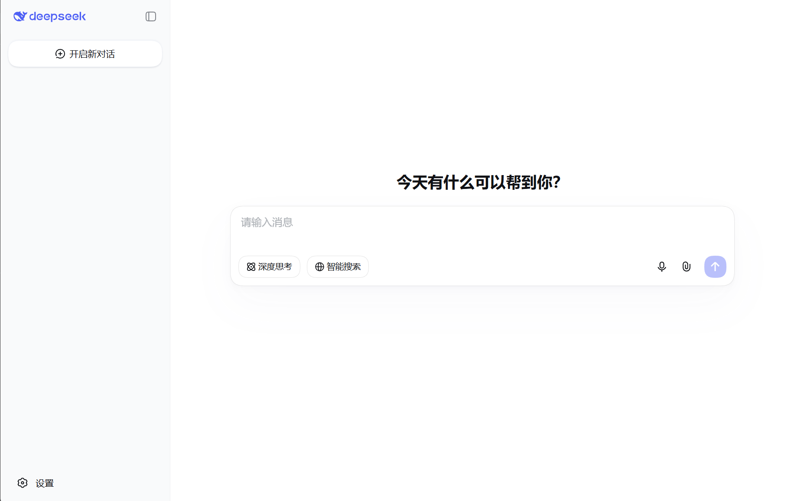
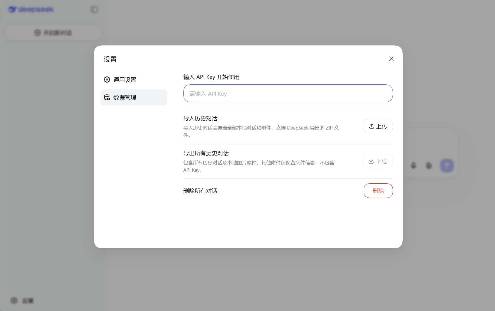
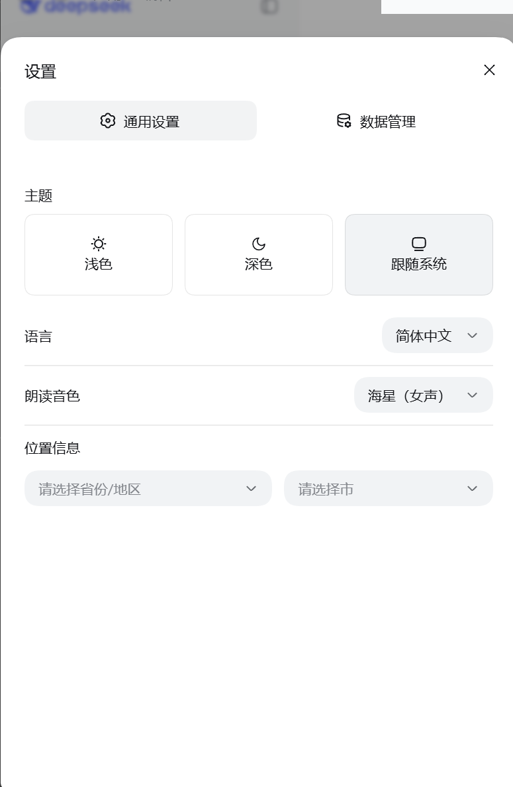

# My DeepSeek

[](https://www.npmjs.com/package/dsh-plugin-my-deepseek)
[](https://github.com/WSK-build/dsh-plugin-my-deepseek/actions/workflows/ci.yml)
[](https://www.npmjs.com/package/dsh-plugin-my-deepseek)
[](LICENSE)

**A native replica of the DeepSeek chat app, as a panel inside DeepSeek Harness (DSH).** The panel runs
the official [`deepseek-ai/chat-demo`](https://github.com/deepseek-ai/chat-demo) front end — not an
imitation — with one change: conversations are written to a folder on this machine, so clearing the
browser cache no longer loses them.

English · [简体中文](README.md)

## Screenshots

| Desktop | Mobile |
| --- | --- |
|  |  |
|  |  |

## Install

### Requirements

| | |
| --- | --- |
| DSH | `>= 0.2.2-rc.1` (declared as `engines.dsh`; verified on 0.2.2-rc.1 and 0.2.2-rc.3, older runtimes are refused) |
| DeepSeek API key | required — you provide your own, it is never bundled |
| Node.js | **not needed** — the built bundle ships with the package |

### Option 1: plugin manager (recommended)

1. Open **Plugins** in DSH;
2. install `dsh-plugin-my-deepseek`;
3. enable the bundle — **My DeepSeek** appears in the sidebar.

### Option 2: command line

```bash
dsh plugin add dsh-plugin-my-deepseek
```

Then enable the bundle in **Plugins**.

### Option 3: from source

```bash
git clone https://github.com/WSK-build/dsh-plugin-my-deepseek.git
cd dsh-plugin-my-deepseek
pnpm install
pnpm build
```

Then install this directory as a bundle.

> **One copy per profile.** The host route prefix is fixed (`/my-deepseek/api`), so a second copy fails
> activation with a duplicate-route error. Switching from a local directory install to the npm version
> can fail with `EPERM` until the old copy is removed from the plugin manager.

## First run

Open **My DeepSeek** in the sidebar. The first visit asks for a DeepSeek API key (Settings → paste; it is
verified against `GET /models`, which costs nothing). Without a key every action routes to Settings —
that is the upstream app's own behaviour, not a broken button.

## Features

- **The official front end**: multi-conversation history, automatic titles, message branches,
  regenerate, stop, continue, attachments (upload / paste / drag), voice input and read-aloud.
- **Deep thinking and web search** with source citations, streamed into the same UI.
- **Markdown, code highlighting, KaTeX and Mermaid**.
- **ZIP history import/export**, using the archive format the official app exports.
- **Local persistence**: one JSON file per conversation; the browser only caches it.

## Data and privacy

| Data | Stored in | Closing the browser | Clearing site data |
| --- | --- | --- | --- |
| Conversations (text, thinking, citations, search results) | local disk, `sessions/<id>.json` | survives | **survives** |
| API key | this browser's `localStorage` (per origin) | survives | lost, enter it again |
| Panel settings | same `localStorage` | survives | reset to defaults |
| Attachment originals | this browser's IndexedDB | survives | lost (messages stay, files do not open) |

Data directory (override with `DSH_CHAT_DATA_DIR`):

| Platform | Path |
| --- | --- |
| Windows | `%LOCALAPPDATA%\my-deepseek-panel\sessions` |
| macOS | `~/Library/Application Support/my-deepseek-panel/sessions` |
| Linux | `$XDG_DATA_HOME/my-deepseek-panel/sessions` (default `~/.local/share`) |

One file per conversation, written atomically (temp file + rename), so a crash cannot leave a
half-written session behind.

`localStorage` is not a cache: closing the browser keeps it; a different browser, a private window or a
different port starts without it. **The API key never leaves your machine and is never written to disk
by this package** — the panel calls `api.deepseek.com` directly from your browser.

No telemetry, no analytics, no account. The only network calls are the ones the chat itself makes to the
DeepSeek API you configured.

## Import and export

Settings → Data management:

- **Import history** accepts the ZIP archive exported by the official DeepSeek app. Importing replaces
  the panel's conversations.
- **Export** produces the same format, with the original image attachments when they are available
  locally.

## Known limits

- **Conversations are not DSH sessions.** They are this plugin's own files: they do not appear in the
  DSH sidebar, session search, or the DSH session log. That is deliberate — it keeps the replica's
  fidelity (thinking signatures, inline citation anchors, server-side search blocks) intact and keeps
  the package independent of DSH's data model.
- **The model is fixed** to `deepseek-flash`, the default of the official demo.
- **Attachment originals stay in the browser.** After clearing site data, an old message still shows its
  text and file name, but opening the file fails.
- **One copy per DSH profile.**

## Develop

```bash
pnpm install
pnpm build      # transform tokens -> rspack bundle -> wrap into a DSH client module
pnpm run audit  # module id, baseline-only externals, embedded CSS, privacy scan
pnpm pack:check # what npm would publish
```

```text
index.js                 host half: the on-disk conversation store, one route prefix
dist/client.js           built client module (generated, not committed)
icon.svg                 official whale mark, generated
src/entry.tsx            mounts the demo's <App /> in the panel, syncs the theme
src/brand-wordmark.tsx   official wordmark artwork, generated
src/store-api.ts         client for the store routes
src/root.css             panel root placement
vendor/chat-demo-src/    upstream demo source (see NOTICE for the exact changes)
scripts/                 token rename, bundling, wrapping, artwork extraction, audits
```

`dist/` is generated by `prepack`, so `npm publish` always ships a fresh bundle.

## Release

Publishing runs in CI; a local `npm login` is never required.

1. npmjs.com → Access Tokens → new **Granular** token: `read and write`, *All packages*;
2. store it as the repository secret `NPM_TOKEN`
   (Settings → Secrets and variables → Actions);
3. bump and tag:

   ```bash
   npm version patch --no-git-tag-version
   git commit -am "release: v0.1.2"
   git tag v0.1.2
   git push origin main --tags
   ```

4. The `release` workflow checks that the tag matches `package.json`, builds, audits, then runs
   `npm publish --provenance`. Manual runs default to a dry run.

Provenance is only generated for a public repository, and `repository.url` must point at it.

## How it differs from the upstream demo

The upstream demo is a standalone static site. This package keeps its UI intact and changes only the
plumbing:

- design tokens are renamed into a private `--dsc-*` namespace and page rules are scoped to the panel —
  the panel keeps the official palette without touching DSH's own theme tokens;
- the sidebar title shows the official wordmark;
- conversation persistence moves from IndexedDB to the host half, which writes one JSON file per
  conversation under the platform data directory.

See [NOTICE](NOTICE) for the full list.

## Trademarks and credits

The DeepSeek name, whale mark and wordmark are trademarks of DeepSeek; they are used here only to
identify the product being replicated and are not covered by the MIT license. **This project is
unofficial and is not affiliated with, endorsed by or supported by DeepSeek.** The upstream demo is MIT
licensed (see [`vendor/LICENSE`](vendor/LICENSE)); this project's own code is MIT licensed too (see
[`LICENSE`](LICENSE)).
