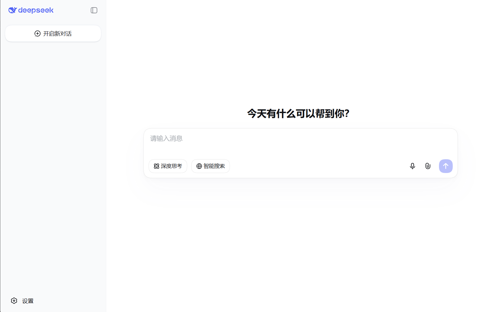
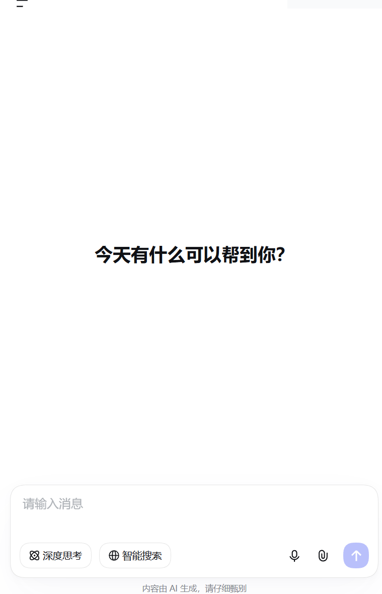
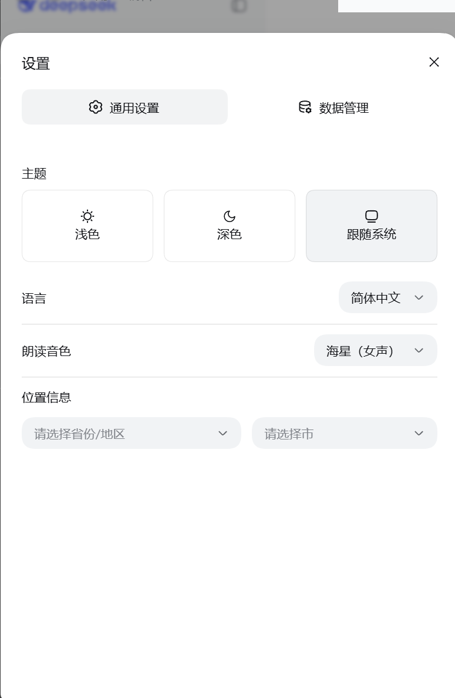

# My DeepSeek

[](https://www.npmjs.com/package/dsh-plugin-my-deepseek)
[](https://github.com/WSK-build/dsh-plugin-my-deepseek/actions/workflows/ci.yml)
[](https://www.npmjs.com/package/dsh-plugin-my-deepseek)
[](LICENSE)

> An unofficial DeepSeek chat panel for **DeepSeek Harness (DSH)** — a native replica of the official
> DeepSeek chat app, with conversations stored on local disk instead of the browser.

This package bundles the official [`deepseek-ai/chat-demo`](https://github.com/deepseek-ai/chat-demo)
front end and mounts it as a DSH panel. You get the real DeepSeek chat UI — not an imitation — with one
addition: your conversations are written to a folder on this machine, so clearing the browser cache no
longer loses them.

## Screenshots

| Desktop | Mobile |
| --- | --- |
|  |  |
|  |  |

## What you get

- **The official front end.** Multi-conversation history with automatic titles, message branches,
  regenerate, stop, continue, attachments (upload / paste / drag), voice input and read-aloud.
- **Deep thinking and web search**, with source citations, streamed into the same UI you already know.
- **Markdown, code highlighting, KaTeX and Mermaid** in replies.
- **ZIP history import/export**, using the archive format the official app exports.
- **Local persistence.** Every conversation is one JSON file on disk; the browser only caches it.

## Requirements

| | |
|---|---|
| DSH | `^0.2.2-rc.3` (declared as `engines.dsh`; verified on DSH 0.2.2-rc.3, and the plugin manager refuses runtimes outside that range) |
| DeepSeek API key | required — enter your own in the panel's Settings |
| Node.js | not needed to install; only to build from source |

## Install

From npm (once published):

- **Plugin manager (recommended).** Open **Plugins** in DSH, install `dsh-plugin-my-deepseek`, and enable
  the bundle. The manager adds the package to the profile and activates its rows.
- **CLI.** `dsh plugin add dsh-plugin-my-deepseek` adds the package to the current profile; enable the
  bundle afterwards in **Plugins**.

From source:

```bash
git clone https://github.com/WSK-build/dsh-plugin-my-deepseek.git && cd dsh-plugin-my-deepseek
pnpm install
pnpm build           # produces dist/client.js
```

then install this directory as a bundle. One copy per profile: the host route prefix is fixed, so a
second copy fails activation with a duplicate-route error.

## First run

Open **My DeepSeek** in the DSH sidebar. On the first visit the panel asks for a DeepSeek API key
(Settings → paste the key; it is verified against `GET /models`, which costs nothing). Without a key the
panel routes every action to Settings — that is the upstream app's own behaviour, not a broken button.

## Where your data lives

| Data | Location | Closing the browser | Clearing site data |
|---|---|---|---|
| Conversations | `%LOCALAPPDATA%\my-deepseek-panel\sessions\*.json` (Windows), `~/Library/Application Support/my-deepseek-panel/sessions` (macOS), `$XDG_DATA_HOME/my-deepseek-panel/sessions` (Linux) | survives | **survives** |
| API key | this browser's `localStorage`, per origin | survives | lost, enter it again |
| Panel settings | same `localStorage` | survives | reset |
| Attachment originals | this browser's IndexedDB | survives | lost (messages remain, files do not open) |

Set `DSH_CHAT_DATA_DIR` to store conversations somewhere else. One file per conversation, written
atomically (temp file + rename), so a crash cannot leave a half-written session behind.

`localStorage` is not a cache: closing the browser keeps it; a different browser, a private window or a
different port starts without it. **The API key never leaves your machine and is never written to disk
by this package** — the panel calls `api.deepseek.com` directly from your browser.

There is no telemetry, no analytics and no account. The only network calls are the ones the chat itself
makes to the DeepSeek API you configured.

## Import and export

Settings → Data management → **Import history** accepts the ZIP archive exported by the official
DeepSeek app. Importing replaces the panel's conversations; **Export** produces the same format, with
the original image attachments when they are available locally.

## Known limits

- **Conversations are not DSH sessions.** They are this plugin's own files: they do not appear in the
  DSH sidebar, session search, or the DSH session log. That is deliberate — it keeps the replica's
  fidelity (thinking signatures, inline citation anchors, server-side search blocks) intact and keeps
  the package independent of DSH's data model.
- **The model is fixed** to `deepseek-flash`, the default of the official demo.
- **Attachment originals stay in the browser.** After clearing site data, an old message still shows its
  text and file name, but opening the file fails.
- **One copy per DSH profile.**

## Develop

```bash
pnpm install
pnpm build      # transform tokens -> rspack bundle -> wrap into a DSH client module
pnpm run audit  # module id == package name, baseline-only externals, embedded CSS, privacy scan
pnpm pack:check # what npm would publish
```

```text
index.js                 host half: the on-disk conversation store, one route prefix
dist/client.js           built client module (generated, not committed)
icon.svg                 official whale mark, generated
src/entry.tsx            mounts the demo's <App /> in the panel, syncs the theme
src/brand-wordmark.tsx   official wordmark artwork, generated
src/store-api.ts         client for the store routes
src/root.css             panel root placement
vendor/chat-demo-src/    upstream demo source (see NOTICE for the exact changes)
scripts/                 token rename, bundling, wrapping, artwork extraction, audits
```

`dist/` is generated by `prepack`, so `npm publish` always ships a fresh bundle.

## Release

Publishing runs in CI, so a local `npm login` is never required — useful when the npm account and
the git identity use different email addresses. The npm account is identified by the token, not by
its email.

1. **Create a granular access token** — npmjs.com → Access Tokens → Generate New Token → *Granular*:
   `read and write`, *All packages*, and enable **Bypass two-factor authentication** so the workflow
   does not need an OTP.
2. **Store it** as the repository secret `NPM_TOKEN`
   (Settings → Secrets and variables → Actions → New repository secret).
3. **Bump the version and tag it:**

   ```bash
   npm version patch --no-git-tag-version   # or minor / major
   git commit -am "release: v0.1.1"
   git tag v0.1.1
   git push origin main --tags
   ```

4. The `release` workflow checks that the tag matches `package.json`, builds, audits, then runs
   `npm publish --provenance`. Manual runs from the Actions tab default to a dry run.

Provenance is only generated for a public repository, and `repository.url` in `package.json` must
point at it. The npm account email and the commit email are independent — npm does not compare them.

## How it differs from the upstream demo

The upstream demo is a standalone static site. This package keeps its UI intact and changes only the
plumbing:

- design tokens are renamed into a private `--dsc-*` namespace and page rules are scoped to the panel —
  the panel keeps the official palette without touching DSH's own theme tokens;
- the sidebar title shows the official wordmark;
- conversation persistence moves from IndexedDB to the host half, which writes one JSON file per
  conversation under the platform data directory.

See [NOTICE](NOTICE) for the full list.

## Trademarks and credits

The DeepSeek name, whale mark and wordmark are trademarks of DeepSeek; they are used here only to
identify the product being replicated and are not covered by the MIT license. **This project is
unofficial and is not affiliated with, endorsed by or supported by DeepSeek.** The upstream demo is MIT
licensed (see [`vendor/LICENSE`](vendor/LICENSE)); this project's own code is MIT licensed too (see
[`LICENSE`](LICENSE)).

## 中文摘要

在 **DeepSeek Harness** 里原生复刻 DeepSeek 聊天 App 的体验：面板跑的是官方 chat-demo 前端本体，
支持深度思考、联网搜索与引用、附件、语音、KaTeX、Mermaid 与多会话，并可导入官方 App 导出的 ZIP
历史。对话记录写在本地磁盘（`%LOCALAPPDATA%\my-deepseek-panel\sessions`），清浏览器缓存不会丢；
API Key 只保存在你自己的浏览器里。本项目为非官方复刻，图标与字标为 DeepSeek 官方资产，商标归
DeepSeek 所有，仅用于标识所复刻的产品。
