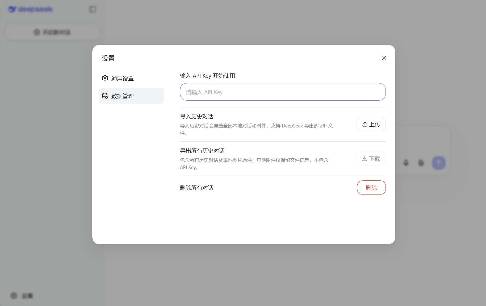

# My DeepSeek

[](https://www.npmjs.com/package/dsh-plugin-my-deepseek)
[](https://github.com/WSK-build/dsh-plugin-my-deepseek/actions/workflows/ci.yml)
[](https://www.npmjs.com/package/dsh-plugin-my-deepseek)
[](LICENSE)

**把官方 DeepSeek 聊天前端做成四种形态：DSH 插件面板、Android 应用、鸿蒙应用、网页体验版。**
界面跑的是官方 [`deepseek-ai/chat-demo`](https://github.com/deepseek-ai/chat-demo) 本体，不是仿制；
四种形态共用同一份网页层源码。

[English](README.en.md) · 简体中文

## 四种形态

| 形态 | 怎么得到 | 需要什么 | 登录方式 | 对话存在哪 |
| --- | --- | --- | --- | --- |
| **DSH 插件面板** | 装 npm 包，在 DSH 里启用 bundle | DSH `>= 0.2.2-rc.1` | 仅 API Key | 本机磁盘，一个会话一个 JSON 文件 |
| **Android 应用** | 装 APK（CI 产出或本地构建） | Android 10+，系统 WebView ≥ 110 | API Key **或** DeepSeek 账号 | 应用私有 IndexedDB |
| **鸿蒙应用** | 装 HAP（**尚未产出**，见下） | HarmonyOS NEXT | API Key **或** DeepSeek 账号 | 应用私有 IndexedDB |
| **网页体验版** | 打开 Pages 页面 | 现代浏览器 | 仅 API Key | 仅内存，刷新即清空 |

四种形态的界面、快捷键、会话分叉、上下文压缩逻辑完全一致，差别只在宿主能力与存储。
「仅」表示该形态确实没有另一条登录路径，不是还没做。

> 鸿蒙这条线目前只到源码与配置：本机没有 DevEco 与 HarmonyOS SDK，**从未编译过**，
> 因此还没有可安装的 HAP。需要用的时候先走 Android 或网页体验版。

## 截图

| 桌面端 | 手机端 |
| --- | --- |
|  |  |
|  |  |

## 一、装成 DSH 插件面板

插件面板是 DSH 的一个 bundle：宿主半边（`dsh-plugin/index.js`）在 DSH 进程里提供会话存储路由，
客户端半边（`dsh-plugin/dist/client.js`）在面板里渲染界面。它只在 DSH 内部工作，不能单独打开。

### 前置条件

| 项 | 要求 |
| --- | --- |
| DSH | `>= 0.2.2-rc.1`（声明在 `engines.dsh`；已在 0.2.2-rc.1 与 0.2.2-rc.3 上验证，更早版本会拒绝安装） |
| DeepSeek API Key | 必需，自己填写，不随包分发 |
| Node.js | **不需要**，包内已带构建产物 |

### 方式一：插件管理器（推荐）

1. 打开 DSH 的 **插件** 页面；
2. 安装 `dsh-plugin-my-deepseek`；
3. 启用该 bundle，侧边栏出现 **My DeepSeek** 入口。

### 方式二：命令行

```bash
dsh plugin add dsh-plugin-my-deepseek
```

装完后仍需在 **插件** 页面启用 bundle。

### 方式三：从源码

```bash
git clone https://github.com/WSK-build/dsh-plugin-my-deepseek.git
cd dsh-plugin-my-deepseek
pnpm install
pnpm build
```

然后把这个目录作为 bundle 安装。

> **只能装一份。** 宿主路由前缀是固定的 `/my-deepseek/api`，装第二份会以「路由重复」失败激活。
> 从本地目录切到 npm 版本时，若安装报 `EPERM`，先在插件页面卸载旧的一份。

## 二、装成 Android 应用

设计上，APK 由仓库的 `release` workflow 在打 tag 时产出并挂到 Release。
**这条流水线还没有在 GitHub 上实际跑过**；已验证的是本地构建路径（见下）。

| 项 | 要求 |
| --- | --- |
| 系统 | Android 10（API 29）及以上 |
| 系统 WebView | 主版本 **≥ 110** |
| 体积 | 13.1 MB（debug 包；纯 WebView 实现，不含原生库） |

系统 WebView 版本不足时，应用启动会给出更新提示，而不是白屏——界面与平台登录页都依赖
较新的渲染引擎。国产 ROM 请在「设置 → 应用 → Android System WebView」中更新。

本地构建：

```bash
pnpm build:mobile            # 仓库根，产出 build/mobile/www
.\android\build-apk.cmd      # 复制到 webDir → cap sync → assembleDebug
.\android\build-apk.cmd -Release   # 未签名 release
```

Windows 默认执行策略会拦 `.ps1`，所以入口是 `.cmd`（以当前进程的 Bypass 作用域代跑脚本，
不改系统设置）。构建需要 JDK 21 与 Android SDK。

## 三、装成鸿蒙应用

`harmony/` 是 ArkTS + ArkWeb 壳，加载与 Android 相同的整页产物。
**这条线尚未编译验证过**：DevEco Studio 与 HarmonyOS SDK 需要华为账号下载，托管 CI 装不了，
因此 HAP 预期由华为云 CodeArts 的 HarmonyOS 构建环境产出，再回传 Release。

已实现的差异点：授权页交给系统浏览器打开，回环回调由应用内的 TCP 服务接收。

## 四、网页体验版

GitHub Pages 上的「用完即走」版本：**不保存任何数据**。

| 数据 | 处理 |
| --- | --- |
| 会话 | 内存，刷新即清空 |
| API Key | 内存，刷新即清空 |
| 附件 | 内存，刷新丢失 |
| 界面偏好 | 内存，刷新回到默认 |
| 导入历史 | 不提供 |
| 账号登录 | 不可用（无原生桥，入口自动隐藏） |

页面顶部有一条可关闭的提示条说明这一点。

## 登录方式

| 形态 | API Key | DeepSeek 账号 |
| --- | --- | --- |
| DSH 插件面板 | ✅ | ❌（面板没有原生桥，入口自动隐藏） |
| Android 应用 | ✅ | ✅ |
| 鸿蒙应用 | ✅ | ✅ |
| 网页体验版 | ✅ | ❌（无原生桥，入口自动隐藏） |

**两种方式二选一。** 账号登录在应用内的 WebView 里完成授权，令牌存进系统密钥库，
请求由原生侧代发并附加鉴权头——网页层始终拿不到令牌明文。
用账号登录后无需再填 API Key。

账号模式有一个已知限制：**附件上传需要 API Key**。上传接口只接受 `x-api-key`，
所以纯账号登录时附件入口是禁用的，鼠标悬停会说明原因。

## 功能

- **官方前端本体**：多会话历史、自动标题、消息分支、重新生成、停止、继续、附件（上传 / 粘贴 / 拖拽）、语音输入与朗读。
- **深度思考与联网搜索**，带来源引用，流式输出在同一个界面里。
- **Markdown、代码高亮、KaTeX、Mermaid**。
- **会话分叉**：AI 回复操作区最右侧的分支图标，从该条回复派生出新会话。标题自动编号
  （`A` → `A(1)` → `A(1-1)`），新会话完整继承当时的消息树，可继续切换早期版本。
- **上下文压缩**：设置 → 通用 → 上下文压缩，六种策略，默认「DeepSeek Harness 自动摘要」。
  压缩只影响**发给模型的内容**，会话里的原文一条不少，导出永远是完整原文。
- **ZIP 历史导入导出**，使用官方 App 导出的归档格式。

## 数据与隐私

### DSH 插件面板

| 数据 | 存放位置 | 关浏览器 | 清站点数据 |
| --- | --- | --- | --- |
| 对话（正文、思考、引用、搜索结果） | 本地磁盘 `sessions/<id>.json` | 保留 | **保留** |
| API Key | 本浏览器 `localStorage`（按源隔离） | 保留 | 丢失，需重填 |
| 面板设置（语言、主题、开关） | 同上 | 保留 | 恢复默认 |
| 附件原件 | 本浏览器 IndexedDB | 保留 | 丢失（消息文字仍在，文件打不开） |

数据目录（可用环境变量 `DSH_CHAT_DATA_DIR` 覆盖）：

| 平台 | 路径 |
| --- | --- |
| Windows | `%LOCALAPPDATA%\my-deepseek-panel\sessions` |
| macOS | `~/Library/Application Support/my-deepseek-panel/sessions` |
| Linux | `$XDG_DATA_HOME/my-deepseek-panel/sessions`（默认 `~/.local/share`） |

每个会话一个文件，写入是原子的（临时文件 + rename），崩溃不会留下半截会话。

### Android / 鸿蒙应用

| 数据 | 存放位置 |
| --- | --- |
| 对话与附件原件 | 应用私有的浏览器数据库，卸载即清空 |
| API Key | 同一数据库（按源隔离） |
| 账号令牌 | 系统密钥库，AES-GCM 加密，IV 由密钥库生成 |
| 导出文件 | 系统下载目录（Android 经 MediaStore 写入） |

### 通用说明

`localStorage` 不是缓存：关浏览器、重启都还在；换浏览器、无痕窗口、换端口等于新源，需要重新填 Key。
**API Key 只在本机，本项目不会把它写到磁盘**——插件面板直接调用 `api.deepseek.com`。

没有遥测、没有统计。除你配置的 DeepSeek API（或登录时的 platform.deepseek.com）之外，
本项目不发起任何网络请求。

## 导入与导出

设置 → 数据管理：

- **导入历史**：接受官方 DeepSeek App 导出的 ZIP，导入会覆盖现有对话；
- **导出**：生成同格式归档，本地有原件的图片会一起带上。
  - DSH 插件面板与网页体验版：走浏览器下载；
  - Android：写入系统下载目录，完成后提示具体文件名；
  - 鸿蒙：暂未实现，会明确提示「当前平台暂不支持导出到本地文件」。

## 已知限制

- **鸿蒙一条线未编译验证**，导出与流式输出在该平台尚未实现（导出会明确报不支持，不会谎报成功）。
- **对话不是 DSH 会话**：它们只是本项目自己的文件，不会出现在 DSH 侧边栏、会话搜索或会话日志里。这是刻意的——保留官方前端的完整保真度（思考签名、行内引用锚点、服务端搜索块），也让插件不依赖 DSH 的数据模型。
- **模型不写死**，未接入服务端模型列表时回退到 `deepseek-flash`。
- **附件原件留在浏览器**：清站点数据后，旧消息的文字和文件名还在，但打开文件会失败。删除会话时不会回收不再被引用的附件原件。
- **纯账号登录时不能上传附件**，需要填 API Key。
- **超大会话导出**经 base64 过一次内存，几十 MB 的归档在低端设备上可能吃紧。
- **一个 DSH profile 只能装一份。**

## 开发

```bash
pnpm install

pnpm build        # 令牌改名 -> rspack 打包 -> 包装成 DSH 客户端模块
pnpm build:mobile # 独立整页（Android / 鸿蒙共用）
pnpm build:web    # 体验站（内存模式）
pnpm test         # 66 条单测（会话分叉、请求归属、压缩层、熔断表）

pnpm run audit        # 模块 id、外部依赖、内联样式、隐私扫描
pnpm run audit:load   # 产物可加载性（构建期常量是否都替换掉了）
pnpm run audit:i18n   # 中英文案键对齐
pnpm run audit:compat # 语法目标 + 门槛 API 扫描
pnpm run lint:compat  # 源码层门槛 API 扫描
pnpm pack:check       # 查看 npm 会发布哪些文件
```

```text
dsh-plugin/                 npm 包的对外内容
  index.js                  宿主半：本地磁盘会话存储，一个路由前缀
  cordis.patch.yml          bundle 补丁
  dist/client.js            构建产物（生成，不入库）
web/src/entries/            各形态的入口
  dsh.tsx                   挂进 DSH 插件面板
  mobile.tsx                独立整页（Android / 鸿蒙 / 体验站）
web/src/shared/             账号登录、存储抽象、模型来源、会话分叉、上下文压缩
web/src/components/         跨壳复用的界面片段
web/src/styles/             面板与整页的根样式
android/                    Android 原生壳（Capacitor）
harmony/                    鸿蒙原生壳（ArkTS + ArkWeb）
website/                    GitHub Pages 体验站
vendor/chat-demo-src/       上游 demo 源码（改动清单见 NOTICE）
scripts/                    令牌改名、打包、包装、图标提取、审计
```

入口与产物只在 `dsh-plugin/` 下，`package.json` 的 `exports` 与 `files` 都以它为准，
因此各模块目录的源码不会进入 npm 包。`dsh-plugin/dist/` 由 `prepack` 生成，
`npm publish` 永远发的是新构建。

对上游 demo 的改动遵循两条：只改相对 import 路径以指向本项目模块；在既有结构里插入少量调用点，
功能实现留在 `web/`。每一处都登记在 `NOTICE`，升级上游时按清单重放。

## 发布

发布在 CI 里完成，本地不需要 `npm login`。

1. npmjs.com → Access Tokens → 新建 **Granular** token：`read and write`、*All packages*；
2. 存到仓库 secret `NPM_TOKEN`（Settings → Secrets and variables → Actions）；
3. 升版本并打 tag：

   ```bash
   npm version patch --no-git-tag-version
   git commit -am "release: v0.1.2"
   git tag v0.1.2
   git push origin main --tags
   ```

4. `release` workflow 会校验 tag 与 `package.json` 版本一致，然后并行做三件事：
   - 构建并 `npm publish --provenance`；
   - 构建 debug APK（配置了签名 secret 时同时产出已签名 release APK），挂到 Release；
   - 构建体验站并部署到 GitHub Pages。

   手动触发默认是 dry run。

体验站的 Pages 需要一次性配置：仓库 Settings → Pages → Source 选 **GitHub Actions**。

APK 签名需要 `ANDROID_KEYSTORE_BASE64`、`ANDROID_KEYSTORE_PASSWORD`、`ANDROID_KEY_ALIAS`、
`ANDROID_KEY_PASSWORD` 四个 secret，必须成套配置：未配置 Base64 时只产出 debug APK，
其余三项缺失会让签名步骤直接失败。

provenance 只在公开仓库生成，且 `repository.url` 必须指向它。

## 与上游 demo 的差异

上游 demo 是一个独立的静态站点。本项目保留它的界面不动，只改管线：

- 设计令牌改名为私有的 `--dsc-*` 命名空间，页面级规则收进面板根节点——沿用官方配色，但不污染 DSH 自己的主题；
- 侧边栏标题换成官方字标；
- 会话持久化从 IndexedDB 移到宿主半（DSH 插件面板），按会话写在平台数据目录下；
- 在既有结构里接入账号登录、会话分叉、上下文压缩、导出落盘等调用点。

完整改动清单见 [NOTICE](NOTICE)。

## 商标与许可

DeepSeek 名称、鲸鱼图标和 `deepseek` 字标是 DeepSeek 的商标，此处仅用于标识被复刻的产品，不在 MIT 许可范围内。
**本项目为非官方项目，与 DeepSeek 无隶属、背书或支持关系。** 上游 demo 为 MIT 许可（见
[`vendor/LICENSE`](vendor/LICENSE)），本项目自有代码同样是 MIT（见 [`LICENSE`](LICENSE)）。
